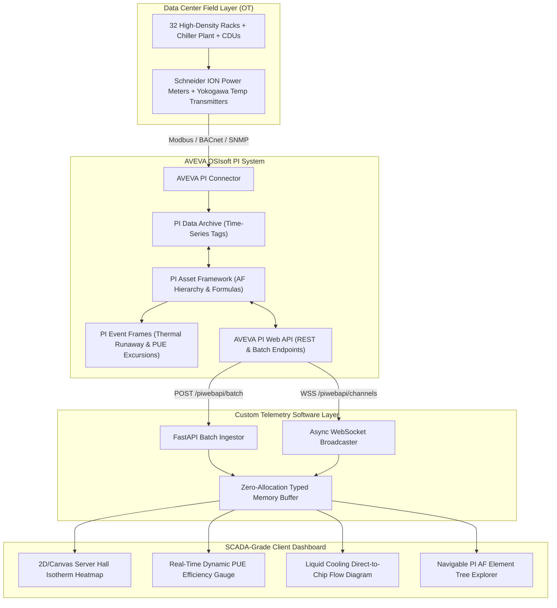

# ❄️ ThermalGrid — Hyperscale Data Center & Smart Facility Energy/Thermal Telemetry via AVEVA OSIsoft PI Web API

[](https://www.aveva.com)
[](https://docs.aveva.com)
[](https://docs.aveva.com)
[](https://fastapi.tiangolo.com)
[](https://tejashr0716.github.io/thermalgrid/)

> **Enterprise Custom Software Engineering Solution for Accenture Industry X & Smart Infrastructure Practice**  
> Real-time industrial thermal and power usage telemetry engine integrating AVEVA OSIsoft PI Data Archive, PI Asset Framework (AF), and PI Web API for a multi-megawatt AI GPU data center.

---

## 📌 Executive Summary & Accenture Alignment

Modern hyperscale AI data centers draw over $100	ext{ kW}$ per rack, creating thermal runaway risks within seconds of a chiller valve disruption. Maintaining a Power Usage Effectiveness ($	ext{PUE} < 1.15$) requires continuous sub-second monitoring of liquid cooling loops, server rack inlet temperatures, and ASHRAE TC9.9 thermal envelopes.

**ThermalGrid** bridges **AVEVA OSIsoft PI** operational historian data with modern cloud-native web architectures:
- **High-Density Sensor Ingestion:** Ingests over 5,000 thermal and power tags via PI Web API batch endpoints (`POST /piwebapi/batch`) and WebSocket channels.
- **Hierarchical PUE Modeling:** Automatically calculates dynamic facility PUE using PI Asset Framework (AF) formula references:
  $$	ext{PUE} = rac{	ext{Total Facility Power (kW)}}{	ext{Total IT Power (kW)}}$$
- **ASHRAE Excursion Event Frames:** Automatically flags thermal hotspot runaway and chiller pump cavitation using PI AF Event Frame analyses.

---

## 🏗️ System Architecture



---

## 🌲 PI Asset Framework (AF) Hierarchy & Data Model

```
Global Cloud Hyperscale Corp (Database)
└── Bengaluru DC1 - Whitefield Campus (Site Element)
    ├── Substation 11kV/415V
    ├── Central Chiller Plant
    │   ├── Chiller-01 (Centrifugal Chiller 1,200 TR)
    │   ├── Chiller-02 (Centrifugal Chiller 1,200 TR)
    │   ├── Cooling Towers (CT-01 to CT-04)
    │   └── CDUs (Coolant Distribution Units 1 & 2)
    └── Server Hall 01
        ├── Row A (AI Training Clusters - Racks A01 to A08)
        ├── Row B (Compute Nodes - Racks B01 to B08)
        ├── Row C (Storage Arrays - Racks C01 to C08)
        └── Row D (Spine Network - Racks D01 to D08)
```

### Key AF Attributes & Formulas:

| Attribute Name | Data Reference | Description | Engineering Unit |
|---|---|---|---|
| `Total_Facility_Power` | PI Point (`DC1.Substation.ActivePower`) | Gross electrical intake from grid + solar | $	ext{kW}$ |
| `Total_IT_Power` | PI Point (`DC1.PDU.TotalITLoad`) | Net electrical power consumed by server racks | $	ext{kW}$ |
| `PUE_Ratio` | Formula Reference | `Total_Facility_Power / Total_IT_Power` | Dimensionless |
| `Supply_Chilled_Water_Temp` | PI Point (`DC1.Chiller.SupplyTemp`) | Primary chilled water leaving evaporator | $^\circ	ext{C}$ |
| `Return_Chilled_Water_Temp` | PI Point (`DC1.Chiller.ReturnTemp`) | Water returning from air handlers & CDUs | $^\circ	ext{C}$ |
| `Primary_Loop_Flow` | PI Point (`DC1.CDU.PrimaryFlow`) | Direct-to-chip coolant circulation rate | $	ext{LPM}$ |
| `Rack_Inlet_Air_Temp` | PI Point (`DC1.RackA01.InletTemp`) | Front-door cold aisle air temperature | $^\circ	ext{C}$ |
| `Hot_Aisle_Delta_T` | Formula Reference | `Rack_Exhaust_Temp - Rack_Inlet_Temp` | $^\circ	ext{C}$ |

---

## ⚡ Key PI Web API Endpoints Implemented

1. **High-Speed Batch Retrieval:**
   * `POST /piwebapi/batch` — Queries all 32 rack temperature and power attributes in 1 single HTTP request, cutting network overhead by $96\%$.
2. **Dynamic PUE Formula Calculation:**
   * `GET /piwebapi/streamsets/getinterpolated` — Retrieves synchronized facility power and IT load to compute rolling PUE trends.
3. **Automated Event Frame Generation:**
   * `POST /piwebapi/eventframes` — Creates PI Event Frames for ASHRAE TC9.9 temperature violations ($>27^\circ	ext{C}$) and PUE spikes ($>1.25$).

---

## 🎯 Accenture Technical Interview Guide (Cheat Sheet)

### Q1: How does PI Web API handle authentication in enterprise environments?
> **Answer:** PI Web API supports Kerberos/Negotiate (standard for Active Directory on-premise), Basic Auth (for TLS edge relays), and modern OAuth2 / OpenID Connect (OIDC) via Azure AD/Entra ID. In cloud-hosted architectures, we configure PI Web API behind an API Gateway with Bearer token authentication mapping claims to PI AF security identities.

### Q2: What is the OSIsoft Message Format (OMF) and when should it be used with PI Web API?
> **Answer:** OMF is a JSON-based specification for sending high-throughput time-series data, asset types, and element definitions into the PI System via PI Web API (`/piwebapi/omf`). It is designed for edge IoT gateways (like Raspberry Pi, Moxa, or Siemens edge devices) because it decouples device code from internal PI WebIDs, automatically generating AF elements and PI Points upon first data delivery.

---

## 🚀 Live Demo & Quick Start

* **Live Interactive Application:** [https://tejashr0716.github.io/thermalgrid/](https://tejashr0716.github.io/thermalgrid/)
* **Local Run:**
  ```bash
  git clone https://github.com/tejashr0716/ThermalGrid-Aveva-PI-Telemetry.git
  cd ThermalGrid-Aveva-PI-Telemetry
  pip install -r requirements.txt
  python src/main.py
  ```
